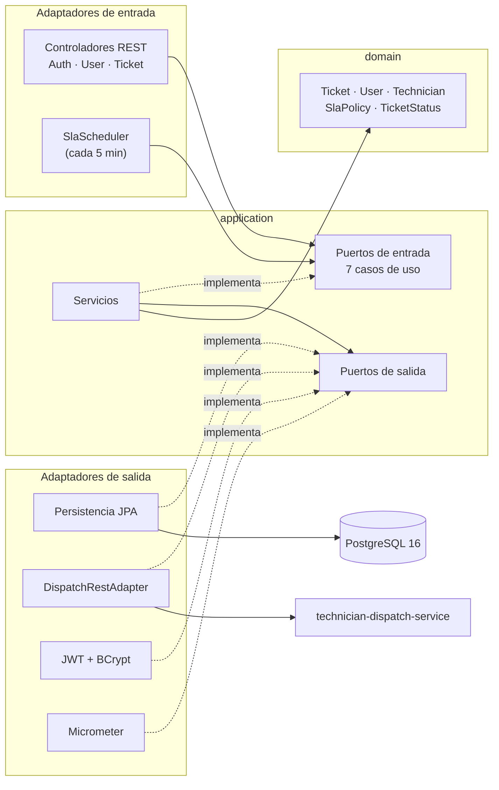
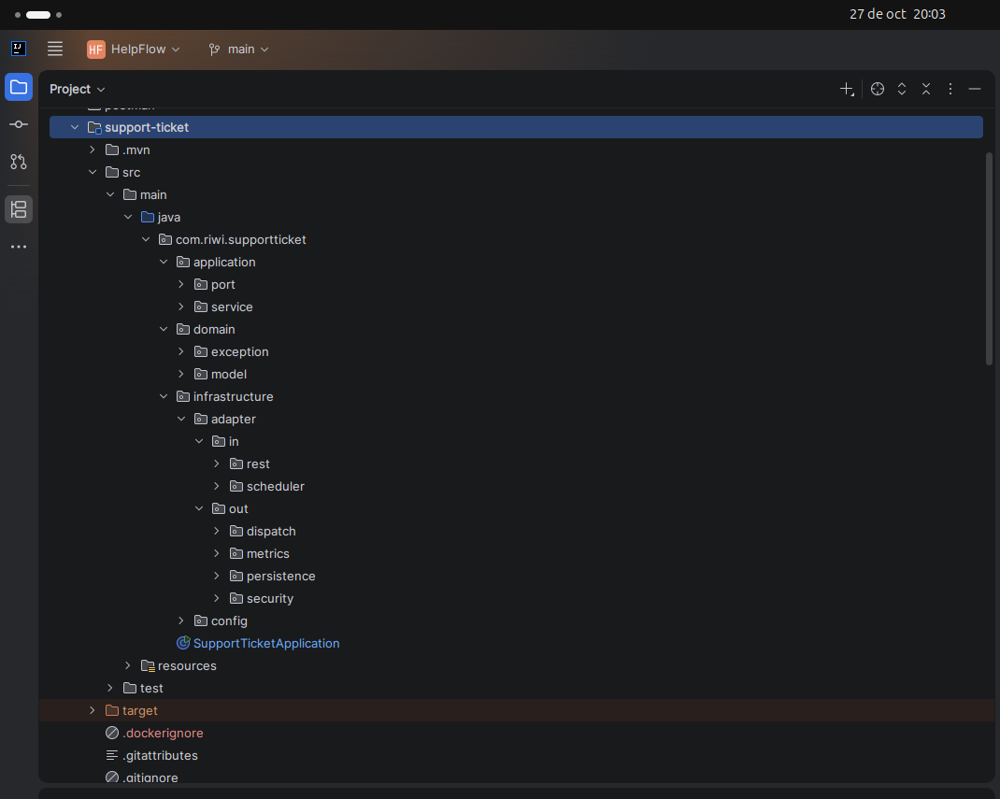
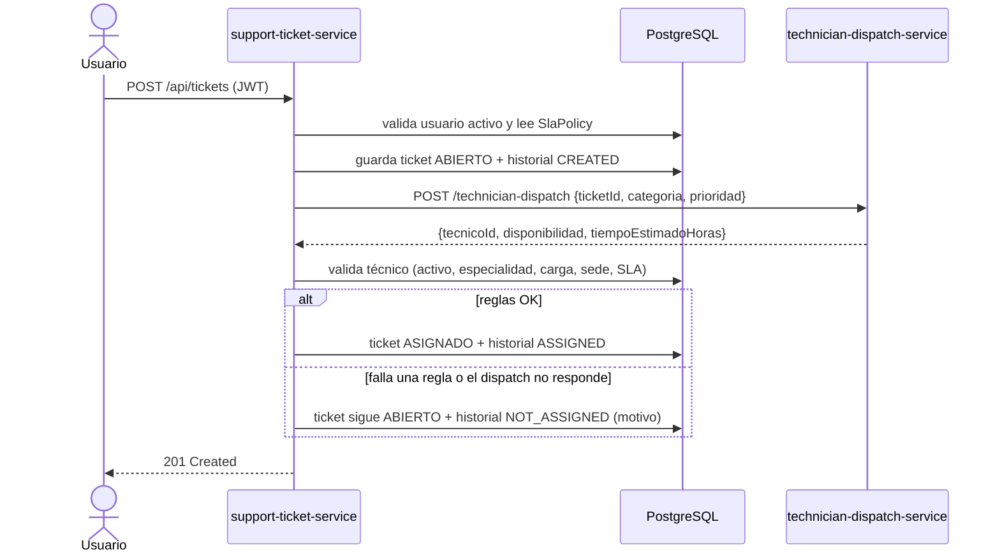
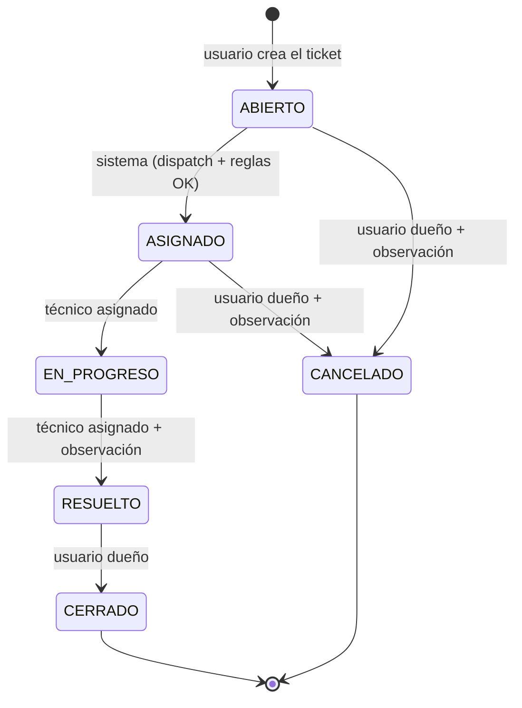
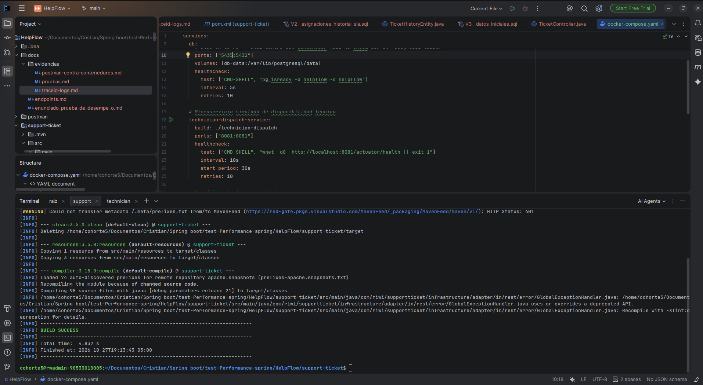
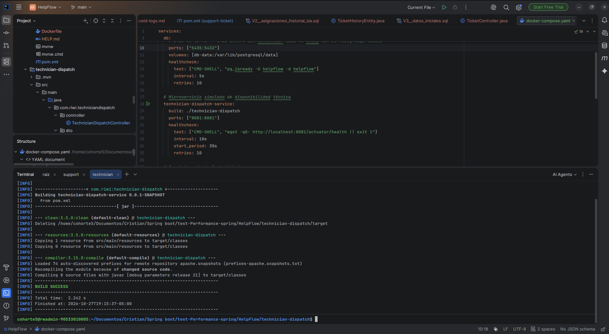
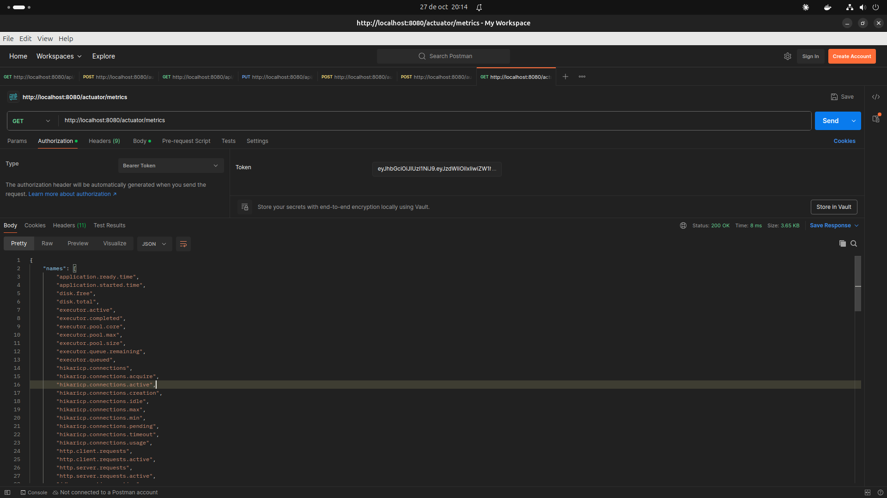
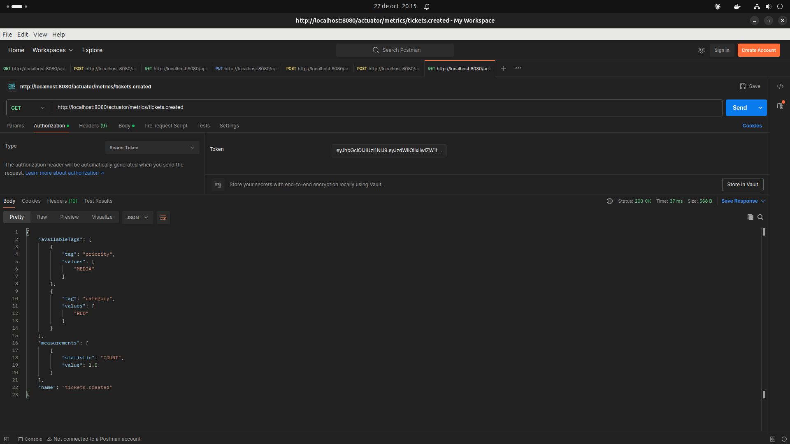
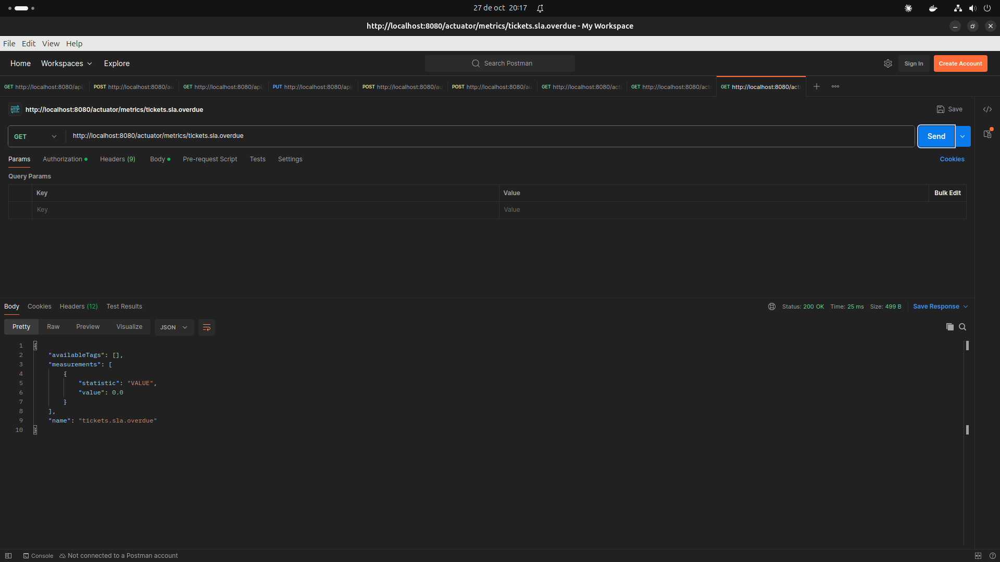

# HelpFlow — Mesa de soporte TI con SLA y asignación automática

Prueba de desempeño Módulo 6 (Riwi). Dos microservicios Spring Boot 4.1 / Java 21:

| Servicio | Puerto | Qué hace |
| --- | --- | --- |
| `support-ticket-service` | 8080 | Usuarios, autenticación JWT, tickets, historial, SLA y escalamiento. Arquitectura hexagonal + PostgreSQL. |
| `technician-dispatch-service` | 8081 | Simula la central de despacho: sugiere un técnico y un tiempo estimado de forma determinista. Sin base de datos ni seguridad. |

> El porqué de cada decisión (y las correcciones al enunciado) está en [ANALISIS.md](ANALISIS.md).

---

## 1. Problema que resuelve

HelpFlow tiene equipos en varias sedes (Barranquilla, Bogotá, Medellín) y gestionaba el soporte por correo y hojas de cálculo: tickets perdidos, sin responsable claro y sin control de tiempos. Este sistema:

- Registra cada solicitud como un **ticket** con categoría, prioridad, sede y activo afectado.
- Calcula una **fecha límite de SLA** según la prioridad.
- Pide a `technician-dispatch-service` un técnico y lo **asigna automáticamente** si cumple las reglas (especialidad, carga, sede y SLA).
- Controla el **ciclo de vida** del ticket con permisos por rol y deja **historial** de cada cambio.
- **Escala** solo los tickets que están por incumplir el SLA y expone **métricas** para medirlo.

---

## 2. Arquitectura hexagonal

Las dependencias apuntan hacia adentro: `domain` no conoce a nadie, `application` solo conoce `domain`, e `infrastructure` es lo único que conoce Spring, JPA, HTTP y Micrometer. Los casos de uso no llevan `@Service`: se registran en `BeanConfig` con `@Bean`.



```text
support-ticket/src/main/java/com/riwi/supportticket/
├── domain/            # modelo + reglas (Java puro) y excepciones de negocio
├── application/       # port/in (casos de uso), port/out (interfaces), service (implementación)
└── infrastructure/
    ├── adapter/in/rest/          # controladores, DTOs, MapStruct, GlobalExceptionHandler
    ├── adapter/in/scheduler/     # SlaScheduler
    ├── adapter/out/persistence/  # entidades, repositorios Spring Data, mappers, adaptadores
    ├── adapter/out/dispatch/     # RestClient hacia technician-dispatch-service (timeout 3 s)
    ├── adapter/out/security/     # JwtTokenProvider, filtro, BCrypt, 401/403
    ├── adapter/out/metrics/      # métricas de negocio
    └── config/                   # BeanConfig, SecurityConfig, OpenApiConfig
```

Así se ve en el IDE:



---

## 3. Relación entre microservicios

Crear y asignar ocurre en **una sola transacción**: si algo falla a la mitad no queda un ticket sin historial. Si el dispatch no responde o el técnico no cumple una regla, el ticket queda ABIERTO con el motivo en el historial.



El dispatch es determinista: convierte `ticketId · 7 + categoria · 3 + prioridad` en un número (seed) y con él elige técnico y horas. Ejemplo del enunciado: ticket 125, RED, ALTA → seed 883 → **TEC-014**, 3 h, disponibilidad **MEDIA**.

El `traceId` viaja en la llamada HTTP (Micrometer Tracing + Brave), así que la misma petición se puede seguir en los logs de los dos servicios.

---

## 4. Ciclo de vida del ticket



Escalar **no** es un estado: sube la prioridad un nivel y queda en el historial.

---

## 5. Roles y permisos

Hay tres roles. Spring Security revisa el **rol** (con el JWT); que el ticket sea del usuario o esté asignado al técnico lo revisa el caso de uso con un `if`.

| Acción | Endpoint | ROLE_USUARIO | ROLE_TECNICO | ROLE_ADMIN |
| --- | --- | --- | --- | --- |
| Registrarse | `POST /auth/register` | ✅ Público; siempre queda como USUARIO y activo | — | — |
| Iniciar sesión | `POST /auth/login` | ✅ Si está activo | ✅ Si está activo (TEC-020 no) | ✅ |
| Ver y editar su perfil (nombre, sede, área) | `GET` / `PUT /api/users/me` | ✅ | ✅ | ✅ |
| Crear ticket | `POST /api/tickets` | ✅ Si está activo | ❌ 403 | ❌ 403 |
| Listar tickets | `GET /api/tickets` | Solo los suyos | Solo los asignados a él | Todos |
| Ver detalle e historial | `GET /api/tickets/{id}` y `/history` | Solo los suyos | Solo los asignados a él | Todos |
| Pasar a EN_PROGRESO | `PATCH /api/tickets/{id}/status` | ❌ | ✅ Sus tickets en ASIGNADO | ❌ |
| Pasar a RESUELTO (con observación) | `PATCH /api/tickets/{id}/status` | ❌ | ✅ Sus tickets en EN_PROGRESO | ❌ |
| Cancelar (con observación) | `PATCH /api/tickets/{id}/status` | ✅ Sus tickets en ABIERTO o ASIGNADO | ❌ | ❌ |
| Cerrar | `PATCH /api/tickets/{id}/status` | ✅ Sus tickets en RESUELTO | ❌ | ❌ |
| Ver métricas | `GET /actuator/metrics/**` | ❌ 403 | ❌ 403 | ✅ |

**Lo que hace el sistema solo** (ningún rol lo pide):

- **Asignar:** al crear el ticket consulta a `technician-dispatch-service` y, si el técnico cumple las reglas, lo deja ASIGNADO.
- **Escalar:** cada 5 minutos sube un nivel la prioridad de los tickets que gastaron el 75 % de su SLA (una sola vez).

**Qué responde la API cuando no se puede:**

| Situación | Respuesta |
| --- | --- |
| Sin token, token vencido o inválido | **401** |
| El rol no puede hacer esa acción (ej.: técnico crea ticket) | **403** |
| El ticket no es suyo / no está asignado a él | **403** |
| El cambio de estado no sigue el ciclo de vida (ej.: cerrar un ASIGNADO) | **409** |
| Usuario inactivo intenta iniciar sesión o crear ticket | **422** |

> El enunciado le da al admin "reasignación y configuración de SLA"; en este MVP el admin **solo consulta** (ver [ANALISIS.md](ANALISIS.md) §18).

---

## 6. Reglas de negocio

### SLA

Fecha límite = fecha de creación + horas de la prioridad (tabla `sla_policies`). Un ticket vivo (ABIERTO, ASIGNADO o EN_PROGRESO) está **vencido** si ya pasó su fecha límite.

| Prioridad | Tiempo máximo | Se escala al 75 % |
| --- | --- | --- |
| CRITICA | 2 h | 1 h 30 min |
| ALTA | 8 h | 6 h |
| MEDIA | 24 h | 18 h |
| BAJA | 48 h | 36 h |

**Escalamiento:** `SlaScheduler` corre cada 5 minutos; cada ticket vivo que gastó el 75 % de su tiempo sube **un** nivel de prioridad, **una sola vez**, y queda `ESCALATED` en el historial. La fecha límite no se recalcula. En la misma pasada actualiza la métrica `tickets.sla.overdue`.

### Asignación (en este orden)

1. El técnico sugerido existe y está **activo** (TEC-020 del seed está inactivo a propósito).
2. Su **especialidad** sirve para la categoría (OTRO lo atiende cualquiera).
3. Tiene menos de **3 tickets activos** (ASIGNADO + EN_PROGRESO).
4. Si la categoría es **HARDWARE**, es de la **misma sede** del ticket (hay que ir en persona).
5. `ahora + tiempo estimado` **no pasa** la fecha límite del SLA.

### Transiciones y validaciones

- Transición inválida → **409**. Quién puede pedir cada estado → tabla de la sección 5 (si no → **403**).
- `@ValidStatusChange`: RESUELTO y CANCELADO exigen observación (**400**).
- Correo corporativo `@helpflow.com`, documento y correo únicos (**409**), título ≤ 120 caracteres.
- Usuario inactivo (`active = false`) no inicia sesión ni crea tickets (**422**).

Todos los errores salen en formato **ProblemDetail** (RFC 7807) con `type`, `title`, `status`, `detail`, `instance`, `timestamp` y `traceId`:

```json
{
  "type": "https://helpflow.com/problems/invalid-status-transition",
  "title": "Invalid status transition",
  "status": 409,
  "detail": "Ticket 1 cannot move from ASIGNADO to CERRADO",
  "instance": "/api/tickets/1/status",
  "timestamp": "2026-10-27T23:02:00.178Z",
  "traceId": "6ae13215814752666c667b9b83203fac"
}
```

Los errores de `technician-dispatch-service` usan el mismo formato, con el mismo `traceId` que le mandó support-ticket-service.

### Campos enum y booleanos en la base de datos

Los valores con una lista cerrada son tipos **`ENUM` nativos de PostgreSQL** (creados con `CREATE TYPE` en V1 y V2), no `VARCHAR`: la base rechaza cualquier valor que no esté en la lista.

| Tabla.columna | Tipo en PostgreSQL | Enum en Java | Valores permitidos |
| --- | --- | --- | --- |
| `users.role` | `user_role` | `Role` | `USUARIO`, `TECNICO`, `ADMIN` |
| `technicians.specialty` | `technician_specialty` | `Specialty` | `HARDWARE`, `SOFTWARE`, `RED`, `ACCESOS` |
| `tickets.category` | `ticket_category` | `Category` | `HARDWARE`, `SOFTWARE`, `RED`, `ACCESOS`, `OTRO` |
| `tickets.priority` | `ticket_priority` | `Priority` | `BAJA`, `MEDIA`, `ALTA`, `CRITICA` (en ese orden: escalar = subir uno) |
| `tickets.status` | `ticket_status` | `TicketStatus` | `ABIERTO`, `ASIGNADO`, `EN_PROGRESO`, `RESUELTO`, `CERRADO`, `CANCELADO` |
| `ticket_history.action` | `history_action` | `HistoryAction` | `CREATED`, `ASSIGNED`, `NOT_ASSIGNED`, `STATUS_CHANGED`, `ESCALATED` |
| `ticket_history.from_status`, `to_status` | `ticket_status` | `TicketStatus` | Los mismos estados del ticket (`from_status` es `null` en `CREATED`) |
| `sla_policies.priority` (llave) | `ticket_priority` | `Priority` | Una fila por prioridad |

En las entidades JPA cada uno se mapea así:

```java
@Enumerated(EnumType.STRING)              // guarda el nombre (ABIERTO), nunca la posición
@JdbcTypeCode(SqlTypes.NAMED_ENUM)        // lo envía como tipo enum de PostgreSQL, no como varchar
@Column(nullable = false, columnDefinition = "ticket_status")
private TicketStatus status;
```

- **Sin `NAMED_ENUM`** PostgreSQL rechaza el `INSERT` (`column "status" is of type ticket_status but expression is of type character varying`).
- **Nunca `EnumType.ORDINAL`:** si alguien reordena el enum en Java, los números guardados pasan a significar otra cosa sin ningún error.
- Los nombres de los valores son **iguales** en Java y en PostgreSQL; agregar un valor nuevo exige una migración con `ALTER TYPE ... ADD VALUE`.

Lo que solo puede ser **sí o no** es `BOOLEAN`:

| Tabla.columna | Significado |
| --- | --- |
| `users.active` | `true` = activo; `false` = inactivo (no inicia sesión ni crea tickets) |
| `technicians.active` | `true` = habilitado para recibir asignaciones; `false` = no (TEC-020 en el seed) |
| `tickets.escalated` | `true` = ya se escaló una vez (no se vuelve a escalar) |

> El enunciado habla de estado "ACTIVO / INACTIVO"; en el sistema es el booleano `active` (en la API: `"active": true`).


---

## 7. Endpoints

Swagger UI: **http://localhost:8080/swagger-ui.html** (botón *Authorize* para pegar el token).

| Método | Ruta | Quién | Qué hace |
| --- | --- | --- | --- |
| POST | `/auth/register` | Público | Crea usuario con ROLE_USUARIO (201) |
| POST | `/auth/login` | Público | Devuelve el JWT (60 min) |
| GET | `/api/users/me` | Autenticado | Ver mi perfil |
| PUT | `/api/users/me` | Autenticado | Editar nombre, sede y área |
| POST | `/api/tickets` | USUARIO | Crear ticket y asignarlo (201) |
| GET | `/api/tickets` | Autenticado | Listar según rol |
| GET | `/api/tickets/{id}` | Dueño, técnico asignado, admin | Detalle |
| GET | `/api/tickets/{id}/history` | Dueño, técnico asignado, admin | Historial |
| PATCH | `/api/tickets/{id}/status` | Técnico asignado o usuario dueño | `{ "newStatus": "RESUELTO", "observation": "..." }` |
| GET | `/actuator/health`, `/actuator/info` | Público | Salud e información |
| GET | `/actuator/metrics/**` | ADMIN | Métricas |
| POST | `:8081/technician-dispatch` | Interno | `{ "ticketId": 125, "categoria": "RED", "prioridad": "ALTA" }` |

Colección Postman en [`postman/`](postman/): importar `HelpFlow.postman_collection.json` y el environment `HelpFlow.postman_environment.json`, y correrla en orden con el *Runner* (los scripts guardan los tokens y el `ticketId`).

---

## 8. Ejecución

Requisitos: Docker con Compose, Java 21 (solo para correr fuera de Docker).

```bash
# 1. Variables de entorno: copiar el ejemplo y llenarlo
cp .env.example .env
#    DB_PASSWORD=<la que quieras>
#    JWT_SECRET=<mínimo 32 caracteres>

# 2. Todo el sistema (base de datos + 2 servicios)
docker compose up --build -d
docker compose ps                     # los tres deben quedar "healthy"
docker compose logs -f support-ticket-service

# 3. Apagar (con -v también borra la base de datos y vuelve a sembrarla al arrancar)
docker compose down
docker compose down -v
```

Para correr los servicios desde IntelliJ o `./mvnw spring-boot:run`, levantar solo la base (`docker compose up -d db`, queda en el puerto **5435**). `application.properties` lee el `.env` de la raíz.

| Variable | Uso | Por defecto |
| --- | --- | --- |
| `DB_PASSWORD` | PostgreSQL | `helpflow` |
| `JWT_SECRET` | Firma HS256 del JWT | **obligatoria** (compose no arranca sin ella) |
| `DISPATCH_BASE_URL` | URL del dispatch | `http://localhost:8081` (en compose: `http://technician-dispatch-service:8081`) |

Flyway crea el esquema con sus tipos `ENUM` (`V1`, `V2`) y siembra los datos (`V3`); Hibernate solo valida (`ddl-auto=validate`).

Los contenedores corren con `TZ=America/Bogota`: las fechas (`createdAt`, `slaDeadline`) se guardan en hora de Colombia, igual que al correr desde IntelliJ, así que se puede usar la misma base con las dos formas.

---

## 9. Pruebas

```bash
cd support-ticket && ./mvnw verify            # 46 pruebas (necesita Docker para Testcontainers)
cd ../technician-dispatch && ./mvnw verify    # 9 pruebas
```

| Nivel | Qué cubre |
| --- | --- |
| Unitarias de dominio | `TicketStatus` (transiciones), `SlaPolicy` (2/8/24/48 h), `Technician.canHandle` |
| Unitarias de casos de uso (Mockito) | `CreateTicketService` (5 reglas, dispatch caído), `ChangeTicketStatusService` (403/409/422), `EscalateTicketsService` (80 % escala, 50 % no, no repite) |
| Persistencia (Testcontainers) | Migraciones reales V1–V3 (con los tipos `ENUM`), adaptadores JPA, carga activa del técnico |
| Integración (MockMvc + Testcontainers) | Registro → login → token, 401, 403 entre usuarios, ciclo completo del técnico, 409, documento duplicado, **rollback** de la asignación |
| Dispatch | Misma entrada → misma salida, ejemplo del PDF → TEC-014, bordes 2/3/8/9 h, body inválido → 400 |

En las pruebas de integración el dispatch es un mock del puerto (`@MockitoBean`), para que sean reproducibles.

**Ubuntu:** Testcontainers necesita Docker corriendo y el usuario en el grupo `docker` (`sudo usermod -aG docker $USER` y volver a iniciar sesión).

---

## 10. Usuarios de prueba (seed)

Contraseña de **todos**: `123456`

| Correo | Rol | Notas |
| --- | --- | --- |
| `admin@helpflow.com` | ADMIN | Ve todos los tickets y las métricas |
| `ana@helpflow.com` | USUARIO | Sede Barranquilla |
| `carlos@helpflow.com` | USUARIO | Sede Bogotá |
| `tec001@helpflow.com` … `tec020@helpflow.com` | TECNICO | TEC-001 a TEC-020 (ver tabla) |

| Técnicos | Especialidad | Sede | `active` |
| --- | --- | --- | --- |
| TEC-001 a TEC-005 | HARDWARE | Rotando Barranquilla → Bogotá → Medellín | `true` |
| TEC-006 a TEC-010 | SOFTWARE | Rotando | `true` |
| TEC-011 a TEC-015 | RED | Rotando | `true` |
| TEC-016 a TEC-020 | ACCESOS | Rotando | `true`, salvo **TEC-020 `false`** |

Carga máxima de todos: 3 tickets activos. El id de cada técnico coincide con su número (id 14 → TEC-014 → `tec014@helpflow.com`).

---

## 11. Evidencias

Todas las capturas están en [`docs/evidencias/`](docs/evidencias/). Las de métricas se tomaron con Postman contra los contenedores de `docker compose`; las de compilación, desde la terminal de IntelliJ.

### Capturas

#### Compilación de los dos servicios

`./mvnw clean compile` termina en `BUILD SUCCESS` en ambos módulos. El resultado de las pruebas (`./mvnw verify`: 46 en support-ticket y 9 en technician-dispatch, todas en verde) está en [`pruebas.md`](docs/evidencias/pruebas.md), y la corrida de la colección de Postman contra los contenedores (33/33) en [`postman-contra-contenedores.md`](docs/evidencias/postman-contra-contenedores.md).

| support-ticket-service | technician-dispatch-service |
| --- | --- |
|  |  |

#### Métricas expuestas por Actuator

`GET /actuator/metrics` con el token del admin: además de las de Spring Boot (JVM, HTTP, base de datos), aparecen las seis de negocio: `tickets.created`, `tickets.first_response.time`, `tickets.resolution.time`, `tickets.sla.overdue`, `security.auth.failures` y `security.access.denied`.



#### Tickets creados por categoría y prioridad

`GET /actuator/metrics/tickets.created`: `COUNT` es el total y `availableTags` muestra por qué categorías y prioridades se puede filtrar (`?tag=category:RED`).



#### Tickets vencidos según SLA

`GET /actuator/metrics/tickets.sla.overdue`: el gauge que actualiza el `SlaScheduler` cada 5 minutos. En esta captura no había tickets vencidos (`VALUE: 0.0`); la tabla de abajo explica cómo forzar uno.



#### Estructura hexagonal en el proyecto


### Cómo ver las métricas

Las métricas solo las ve el **admin** (con cualquier otro token responde 403). Solo el login lleva body; las métricas son `GET` sin body, con el token en el header:

| Paso | Método y URL | Header | Body |
| --- | --- | --- | --- |
| 1. Login del admin | `POST http://localhost:8080/auth/login` | `Content-Type: application/json` | `{"email":"admin@helpflow.com","password":"123456"}` → copiar `accessToken` |
| 2. Lista de métricas | `GET http://localhost:8080/actuator/metrics` | `Authorization: Bearer <accessToken>` | Ninguno |
| 3. Tickets creados | `GET http://localhost:8080/actuator/metrics/tickets.created` | `Authorization: Bearer <accessToken>` | Ninguno |
| 3b. Filtrado por tag | `GET http://localhost:8080/actuator/metrics/tickets.created?tag=category:RED` | `Authorization: Bearer <accessToken>` | Ninguno |
| 4. Tiempos | `GET http://localhost:8080/actuator/metrics/tickets.first_response.time` (o `tickets.resolution.time`) | `Authorization: Bearer <accessToken>` | Ninguno |
| 5. Vencidos | `GET http://localhost:8080/actuator/metrics/tickets.sla.overdue` | `Authorization: Bearer <accessToken>` | Ninguno |

Lo mismo con `curl`:

```bash
# 1. Token del admin
TOKEN=$(curl -s -X POST http://localhost:8080/auth/login -H 'Content-Type: application/json' \
  -d '{"email":"admin@helpflow.com","password":"123456"}' | sed -E 's/.*"accessToken":"([^"]+)".*/\1/')

# 2. Lista de todas las métricas disponibles
curl -s http://localhost:8080/actuator/metrics -H "Authorization: Bearer $TOKEN"

# 3. Una métrica en particular
curl -s http://localhost:8080/actuator/metrics/tickets.created -H "Authorization: Bearer $TOKEN"

# 4. Filtrada por tag (tickets creados de RED)
curl -s "http://localhost:8080/actuator/metrics/tickets.created?tag=category:RED" -H "Authorization: Bearer $TOKEN"
```

| Métrica | Qué mide | Cómo leerla |
| --- | --- | --- |
| `tickets.created` | Tickets creados, con tags `category` y `priority` | `COUNT`; filtrar con `?tag=category:RED` o `?tag=priority:ALTA` |
| `tickets.first_response.time` | Tiempo desde que se crea hasta EN_PROGRESO | Tiempo medio = `TOTAL_TIME / COUNT` (en segundos); `MAX` es el peor caso |
| `tickets.resolution.time` | Tiempo desde que se crea hasta RESUELTO | Igual que la anterior |
| `tickets.sla.overdue` | Tickets vivos que ya pasaron su fecha límite | `VALUE`; lo actualiza el scheduler cada 5 minutos |
| `security.auth.failures` | Inicios de sesión fallidos | `COUNT` |
| `security.access.denied` | Respuestas 403 | `COUNT` |

Las métricas viven en memoria: se reinician cada vez que arranca el servicio. `tickets.created` responde **404 hasta que se crea el primer ticket** (el contador nace con él); las demás existen desde el arranque. En Postman están en la carpeta *5. Actuator*.

| Evidencia | Cómo reproducirla |
| --- | --- |
| Pruebas en verde | `./mvnw verify` en cada servicio → `Tests run: 46, Failures: 0` y `Tests run: 9, Failures: 0` |
| Métrica de tickets creados | Login como admin y `GET /actuator/metrics/tickets.created` (carpeta *Actuator* de Postman) |
| Tickets vencidos | `GET /actuator/metrics/tickets.sla.overdue`. Para forzarlo sin esperar horas: correr un ticket hacia atrás en la base (`UPDATE tickets SET created_at = created_at - interval '10 hours', sla_deadline = sla_deadline - interval '10 hours' WHERE id = 1;`) y esperar la siguiente pasada del scheduler (o arrancar con `--sla.check-interval-ms=15000`) |
| Mismo `traceId` en los dos servicios | Crear un ticket y buscar el `traceId` de la línea `Ticket N created` en `docker compose logs support-ticket-service`; la línea `Ticket N (...) -> TEC-xxx` de `docker compose logs technician-dispatch-service` tiene el mismo |
| ProblemDetail con `traceId` | Cualquier request de la carpeta *Errores esperados* de Postman |
